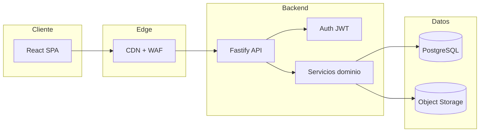

# Arquitectura objetivo

Demo actual: **SPA estática** (React + Vite). Sistema productivo previsto: **monolito modular** o **BFF + API**.

## Calidad — ISO/IEC 25010

| Característica | En demo | En productivo |
|----------------|---------|---------------|
| Adecuación funcional | CRUD local completo | API + reglas de negocio server-side |
| Seguridad | Auth cliente | OWASP ASVS, Argon2, RBAC |
| Compatibilidad | Navegadores modernos | PWA opcional |
| Usabilidad | Tooltips, toasts, i18n es | Onboarding, ayuda contextual |
| Fiabilidad | localStorage | Transacciones DB, backups |
| Mantenibilidad | Módulos por feature | OpenAPI, tests contract |

## Seguridad — OWASP (objetivo)

- **A01 Broken Access Control:** RBAC por rol admin/coordinador
- **A02 Cryptographic Failures:** TLS 1.3, Argon2id, secretos en vault
- **A03 Injection:** Prisma parametrizado, Zod en entrada
- **A05 Security Misconfiguration:** CSP, HSTS, cookies `Secure`/`HttpOnly`
- **A07 Identification and Authentication Failures:** rate limit login, MFA opcional

## Integración

Contratos REST documentados en OpenAPI; eventos de dominio (`EventScheduled`, `EventCompleted`) para analítica futura.

Ver implementación detallada de módulos en [BACKEND.md](BACKEND.md).
